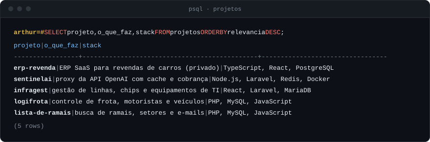
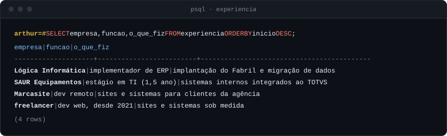

 

 

  
    código aberto:
    <a href="https://github.com/ArthurMts11?tab=repositories&q=infragest">infragest</a>,
    <a href="https://github.com/ArthurMts11?tab=repositories&q=logifrota">logifrota</a> e
    <a href="https://github.com/ArthurMts11?tab=repositories&q=ramais">lista-de-ramais</a>.
    erp-revenda e sentinelai são produtos comerciais com código privado; demo sob pedido.
  

 

  

  

<picture>
  <source media="(prefers-color-scheme: dark)" srcset="https://raw.githubusercontent.com/ArthurMts11/ArthurMts11/output/snake-dark.svg">
  <source media="(prefers-color-scheme: light)" srcset="https://raw.githubusercontent.com/ArthurMts11/ArthurMts11/output/snake-light.svg">
  
</picture>

